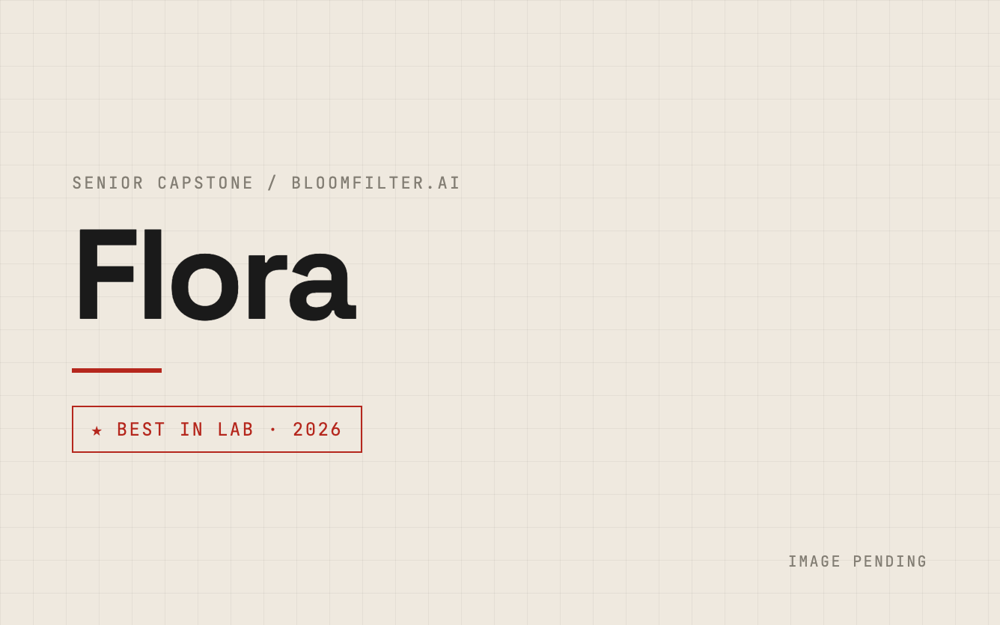
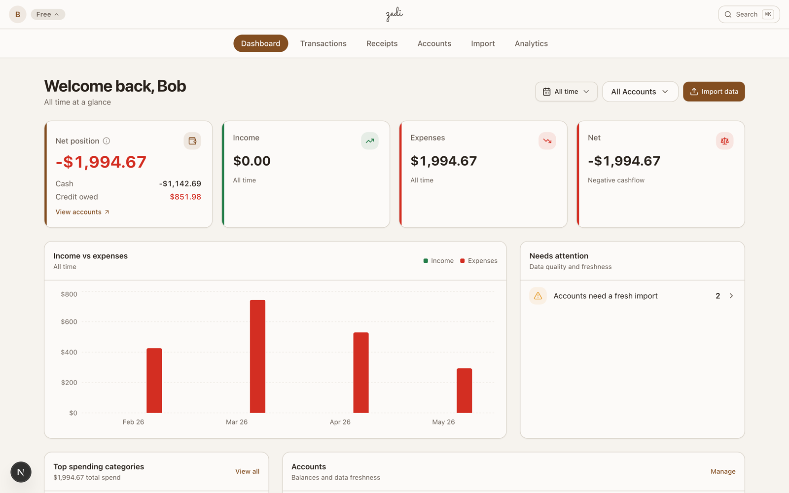
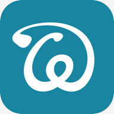

# Handoff: nicolod.org redesign (datasheet aesthetic)

**Date:** 2026-06-25
**Branch:** `redesign/datasheet` (do NOT work on `main`)
**Status:** Mid-implementation. Tasks 1 to 4 done and committed. **You are picking up in the middle of Task 5 (Projects grid), which is not started yet.**

You are an agent continuing an in-progress portfolio redesign. Read this whole file, then continue executing the plan task by task.

---

## What this project is

Personal portfolio at `nicolod.org`, a static HTML/CSS/JS site (no build step) deployed on Cloudflare Pages. We are redesigning the main site only to match the "engineering datasheet" aesthetic of `anthony.diferdinando.com` (the user's brother's site), applied to Nicolo's software / data / security identity. Do NOT touch `os/` (NicoOS).

## The two source-of-truth docs (READ THESE FIRST)

1. **Spec:** `docs/superpowers/specs/2026-06-25-portfolio-redesign-design.md` (the agreed design)
2. **Plan:** `docs/superpowers/plans/2026-06-25-portfolio-redesign.md` (the authoritative 12-task implementation plan with exact markup, copy, CSS specs, and per-task verification + commit steps)

The plan is what you execute. This handoff adds the live runtime state (server, screenshot tool) and the ready-to-paste Task 5 content I had drafted before stopping.

## Workflow context

This work came through the superpowers skills: brainstorming -> writing-plans -> executing-plans. You should **continue in executing-plans mode, inline** (the user chose inline execution with checkpoints, NOT subagents, because visual consistency matters and one agent holding the whole design is better). Invoke the `superpowers:executing-plans` skill to re-anchor if you want, but mainly: follow the plan, one task at a time, commit after each, verify with screenshots.

## Design decisions locked (from the spec)

- **Theme:** cream/light is the DEFAULT, with a dark mode toggle kept. Both use a red accent.
- **Red accent:** `#b5271d` (light), `#e2392c` (dark). Single token `--color-primary`, tune in `styles/base/variables.css`.
- **Cream palette (light):** bg `#f5f2ec`, bg-alt `#efe9df`, surface `#fbf9f4`, text `#1a1a1a`.
- **Fonts:** display = Space Grotesk, body = Inter, mono labels = JetBrains Mono (loaded via Google Fonts in `index.html`).
- **Motif:** LIGHT TOUCH datasheet. Keep the bones (side-photo hero, big bold name, label-left/content-right rows, mono section numbers like `02 / EXPERIENCE`, bordered mono chips, thin rules, one inverted dark Contact section). Drop the heavy gimmicks (no `FIG. 01` everywhere, no title-block table, only a faint graph-paper hint behind the hero).
- **Nav:** single scrolling page, simplified anchor nav: `Profile, Experience, Projects, Stack, Contact` + a Resume pill + theme select. Section ids: `#home #profile #experience #projects #stack #leadership #education #contact` (Leadership and Education are scroll-only, not in the nav bar).
- **Projects:** each gets photos/links; deep ones (Flora, Zedi, Bandit, HomeLab) get their own detail pages.

## Repo rules (IMPORTANT, enforced)

- **NO em-dashes anywhere** (U+2014 banned repo-wide). Use commas, periods, parens, hyphens. There is a guard below; run it before every commit.
- Terse project card copy: 2 to 3 sentences, tech goes in chips not prose.
- Commit per task on `redesign/datasheet`. Commit message footer line: `Co-Authored-By: Claude Opus 4.8 (1M context) <noreply@anthropic.com>`
- The working tree has some UNRELATED pre-existing changes by the user (`M CLAUDE.md`, some deleted `Vx.x ss/*.png` and old `images/*` for dropped projects). Do NOT sweep these into your commits. Only `git add` the specific files each task touches.

## Done and committed (Tasks 1 to 4)

Recent git log on the branch:
```
0820776 redesign: profile statement and experience timeline      <- Task 4
910bfdc redesign: two-column side-photo hero with focus tiles     <- Task 3
ceebd38 redesign: simplified anchor nav, mono links, resume pill  <- Task 2
26013e2 redesign: cream+red tokens, display+mono fonts, light default <- Task 1
cc8e223 Add portfolio redesign implementation plan
8452d39 Add portfolio redesign design spec (datasheet aesthetic)
```
- **Task 1:** `styles/base/variables.css` (cream/red palette, font tokens), `index.html` (fonts link, early-theme default flipped to `light`, css cache-buster `?v=redesign-1`), `js/modules/theme.js` (`defaultTheme = 'light'`). Verified: hero renders cream, dark toggle works.
- **Task 2:** simplified nav markup in `index.html` (desktop + mobile), `styles/components/navigation.css` (theme-aware translucent bar, mono uppercase links, `.navigation__link--btn` resume pill). Kept the existing JS scrollspy (`.active` on `section[id]`) and smooth scroll in `js/modules/navigation.js`.
- **Task 3:** `styles/components/hero.css` REWRITTEN (two-column `.hero__split`, faint graph-paper `::before`, `.hero__eyebrow/__status/__title/__bio/__actions/__aside/__photo/__chip`, `.focus-tiles/.focus-tile`, and the site-wide `.btn/.btn--primary/.btn--secondary/.btn--ghost` which now live here). `index.html` hero markup replaced. Also fixed inline critical CSS in `<head>` (removed `.hero { display:flex !important }` which would break the grid). Verified with screenshots: looks great in cream + mobile stacks cleanly.
- **Task 4:** `index.html` About section replaced with Profile (`01 / PROFILE`) + Experience (`02 / EXPERIENCE`, 5 roles from the resume). Created `styles/components/sections.css` (the shared primitives `.ds-section/.ds-section--alt/.ds-section__num/.ds-statement/.ds-body/.chips/.chip/.chip--accent/.ds-rows/.ds-row/.stack-row/.section--ink`). Wired it into `styles/main.css` and bumped all `@import` cache-busters to `?v=redesign-1`. Verified with screenshots: profile and experience render correctly.

## Remaining work (Tasks 5 to 12) - see the plan for full detail

- **Task 5 (IN PROGRESS, do this next): Projects grid.** Replace the old projects section in `index.html`, rewrite `styles/components/card.css` with the `.proj-*` system, create `images/PLACEHOLDER-flora.png`. Ready-to-paste content is below.
- **Task 6: Stack section** (replaces the old `#certifications` section in `index.html`).
- **Task 7: Leadership + Education** sections.
- **Task 8: Contact (inverted dark, `.section--ink`) + footer.**
- **Task 9: JS cleanup + index finalization** (remove the old `#resume` section, the dead inline `<style>` blocks for `.card--icon-card`/`.card__link--coming-soon`, bump `js/app.js?v=refresh-3` to `?v=redesign-1`, remove counter/stat JS).
- **Task 10: Detail-page template + restyle `bandit.html` and `homelab.html`** (create `styles/components/detail.css`, preserve their existing prose).
- **Task 11: New detail pages `flora.html` + `zedi.html`** (Zedi gallery from `images/zedi-deck-shots/`).
- **Task 12: Responsive + theme + a11y QA pass.**

Old sections still present in `index.html` that later tasks replace/remove: `#resume` (remove in Task 9, resume is now a nav/hero button), `#certifications` (becomes Stack in Task 6).

## Content the USER is providing in parallel (placeholders for now)

- Real **Flora** image (use `images/PLACEHOLDER-flora.png` until then; mark with an HTML comment).
- **Wedge** feature screenshot (using `images/wedge_logo.png` for now).
- **Leadership** briefs for Club Baseball + Kappa Sigma (Task 7 uses placeholder copy marked with `<!-- LEADERSHIP COPY: placeholder, user to replace -->`).

## Assets available (`images/`)

- `Nicolo.jpeg` (hero photo, restored from git earlier; user may drop a new one over it).
- `pc.webp`, `pc1.webp` (PeopleConnect logo, used in hero status tag).
- `wedge_logo.png` (Wedge card).
- `zedi-deck-shots/` gallery: `dashboard(.png/-full.png)`, `accounts`, `transactions`, `analytics`, `receipts`, `xray` (each has a `-full` variant) for the Zedi detail page.
- `Bandit Fancy.png`, `Bandit_Logo_Inverted.png`, `Website Header.png` (HomeLab), `diferdinando-site.png`.

---

## LIVE RUNTIME STATE (recreate in your session)

### Preview server
A static server was running on **port 4321** (`npx http-server`). The user's OWN `zedi-back` dev server runs on **port 3000 - DO NOT touch port 3000**. In a new session the 4321 server is probably gone; restart it from the repo root:
```bash
npx --yes http-server -p 4321 -c-1 . >/tmp/server.log 2>&1 &
# then: curl -s -o /dev/null -w "%{http_code}\n" http://localhost:4321/index.html  (expect 200)
```
(Or just use `npm start`, which runs lite-server, but it auto-opens a browser tab and may also want port 3000. The standalone http-server on 4321 is cleaner.)

### Screenshot tool (how I verified each section)
Headless Chrome CLI canNOT do full-page screenshots in this Chrome build, and the hero's `88vh` distorts tall windows. Use **puppeteer-core driving the system Chrome** instead. Recreate this helper in YOUR scratchpad (the path below is session-specific and will differ for you):
```bash
cd <your-scratchpad>; npm init -y >/dev/null 2>&1; npm install puppeteer-core >/dev/null 2>&1
```
`shot.js`:
```js
const puppeteer = require('puppeteer-core');
const CHROME = '/Applications/Google Chrome.app/Contents/MacOS/Google Chrome';
(async () => {
  const [url, out, widthArg, theme, clipSel] = process.argv.slice(2);
  const width = parseInt(widthArg || '1440', 10);
  const browser = await puppeteer.launch({ executablePath: CHROME, headless: 'new',
    args: ['--no-sandbox', '--hide-scrollbars', '--force-color-profile=srgb'] });
  try {
    const page = await browser.newPage();
    await page.setViewport({ width, height: 1000, deviceScaleFactor: 1 });
    if (theme && theme !== 'default') await page.evaluateOnNewDocument((t) => {
      try { localStorage.setItem('preferredTheme', t); } catch (e) {} }, theme);
    await page.goto(url, { waitUntil: 'networkidle0', timeout: 30000 });
    await new Promise((r) => setTimeout(r, 600));
    const el = clipSel ? await page.$(clipSel) : null;
    if (el) await el.screenshot({ path: out }); else await page.screenshot({ path: out, fullPage: true });
    console.log('OK ' + out);
  } catch (e) { console.error('ERR ' + e.message); process.exit(1); }
  finally { await browser.close(); }
})();
```
Usage: `node shot.js "http://localhost:4321/index.html" out.png 1440 default "#projects"`
- arg4 theme: `default` | `light` | `dark` (seeds localStorage before the early theme script runs)
- arg5 clipSelector: a CSS selector to clip to one section, or omit for full page
Then `Read` the PNG to actually look at it. Verify both light and dark for new sections.

### Verification guards (run before each commit)
```bash
# Guard A: no em-dashes (builds U+2014 so this command stays clean)
em=$(printf '\xe2\x80\x94'); if grep -rn "$em" index.html bandit.html homelab.html flora.html zedi.html styles js 2>/dev/null; then echo "FAIL em-dash"; else echo "PASS"; fi
# Guard B: local asset references resolve
for f in index.html bandit.html homelab.html flora.html zedi.html; do [ -f "$f" ] || continue;
  grep -Eoh '(src|href)="[^"]+"' "$f" | sed -E 's/.*="//; s/"//' | grep -Ev '^(https?:|mailto:|tel:|#|data:)' \
  | while read -r p; do p="${p%%#*}"; p="${p%%\?*}"; [ -z "$p" ] && continue; p="${p#/}"; [ "$p" = "resume.pdf" ] && continue; [ -f "$p" ] || echo "MISSING in $f: $p"; done; done; echo "asset check done"
```

---

## TASK 5: ready-to-paste content (do this first)

### Step A: create the Flora placeholder so Guard B passes
```bash
cp "images/Website Header.png" images/PLACEHOLDER-flora.png
```

### Step B: rewrite `styles/components/card.css` entirely with this `.proj-*` system
The old `.card*` styles are no longer used after Tasks 5 to 6 (the old project cards and the cert cards are being replaced). Replace the whole file with:
```css
/* ===================================
   Project Cards
   =================================== */

.proj-grid {
  display: grid;
  grid-template-columns: repeat(2, 1fr);
  gap: var(--space-8);
}

.proj-card {
  display: flex;
  flex-direction: column;
  background: var(--color-surface);
  border: 1px solid var(--color-border);
  border-radius: var(--radius-sm);
  overflow: hidden;
  transition: transform var(--transition-base), border-color var(--transition-base), box-shadow var(--transition-base);
}

.proj-card:hover {
  transform: translateY(-4px);
  border-color: var(--color-primary);
  box-shadow: var(--shadow-lg);
}

.proj-card__media {
  display: block;
  aspect-ratio: 16 / 10;
  overflow: hidden;
  background: var(--color-surface-alt);
  border-bottom: 1px solid var(--color-border);
}

.proj-card__media img {
  width: 100%;
  height: 100%;
  object-fit: cover;
  transition: transform var(--transition-slow);
}

.proj-card:hover .proj-card__media img {
  transform: scale(1.04);
}

.proj-card__media--logo {
  display: flex;
  align-items: center;
  justify-content: center;
  padding: var(--space-8);
}

.proj-card__media--logo img {
  object-fit: contain;
  transform: none;
}

.proj-card__body {
  display: flex;
  flex-direction: column;
  gap: var(--space-3);
  padding: var(--space-6);
  flex: 1;
}

.proj-card__cat {
  font-family: var(--font-mono);
  font-size: var(--text-xs);
  letter-spacing: 0.1em;
  color: var(--color-text-muted);
  margin: 0;
}

.proj-card__title {
  font-family: var(--font-display);
  font-weight: 600;
  font-size: var(--text-2xl);
  color: var(--color-text-primary);
  margin: 0;
}

.proj-card__url {
  font-family: var(--font-mono);
  font-size: var(--text-sm);
  color: var(--color-primary);
  margin: 0;
}

.proj-card__desc {
  font-size: var(--text-base);
  line-height: 1.65;
  color: var(--color-text-secondary);
  margin: 0;
  max-width: none;
}

.proj-card .chips {
  margin-top: var(--space-2);
}

.proj-card__links {
  display: flex;
  flex-wrap: wrap;
  gap: var(--space-5);
  margin-top: auto;
  padding-top: var(--space-4);
}

.proj-card__link {
  display: inline-flex;
  align-items: center;
  gap: var(--space-2);
  font-family: var(--font-mono);
  font-size: var(--text-sm);
  text-transform: uppercase;
  letter-spacing: 0.04em;
  color: var(--color-primary);
  transition: gap var(--transition-fast);
}

.proj-card__link:hover {
  gap: var(--space-3);
  color: var(--color-primary-dark);
}

.proj-card__muted {
  font-family: var(--font-mono);
  font-size: var(--text-xs);
  letter-spacing: 0.06em;
  text-transform: uppercase;
  color: var(--color-text-muted);
  margin-top: auto;
  padding-top: var(--space-4);
}

.proj-card--tile .proj-card__body {
  padding: var(--space-8) var(--space-6);
  background: radial-gradient(circle at 100% 0%, rgba(181, 39, 29, 0.05), transparent 60%);
}

@media (max-width: 760px) {
  .proj-grid {
    grid-template-columns: 1fr;
    gap: var(--space-6);
  }
}
```

### Step C: replace the projects section in `index.html`
The projects section currently spans from `  <!-- Projects Section -->` to its closing `</section>` (just before `  <!-- Resume Section -->`). Whitespace inside the old block is fiddly, so the robust way is to splice by the comment markers with Python rather than a literal Edit match. Write the new HTML below to a temp file and run:
```python
import re
html = open('index.html').read()
new = open('<tmp>/new_projects.html').read()
start = html.index('  <!-- Projects Section -->')
end = html.index('  <!-- Resume Section -->')
html = html[:start] + new + html[end:]
open('index.html','w').write(html)
```
New projects HTML (note: ends with a blank line + two spaces of indent before the Resume comment is reattached; keep a trailing newline):
```html
  <!-- Projects Section -->
  <section class="ds-section ds-section--alt" id="projects">
    <div class="container">
      <p class="ds-section__num">03 / PROJECTS</p>
      <div class="proj-grid">

        <!-- Flora (TODO: replace PLACEHOLDER-flora.png with real image) -->
        <article class="proj-card">
          <a class="proj-card__media" href="flora.html">
            
          </a>
          <div class="proj-card__body">
            <p class="proj-card__cat">SENIOR CAPSTONE / BLOOMFILTER.AI</p>
            <h3 class="proj-card__title">Flora</h3>
            <p class="proj-card__desc">Year-long senior capstone with Bloomfilter, improving HCI for AI-agent integration inside project-management tools, with a focus on driving adoption in enterprise software.</p>
            <div class="chips"><span class="chip">HCI</span><span class="chip">AI Agents</span><span class="chip">Research</span></div>
            <div class="proj-card__links"><a class="proj-card__link" href="flora.html">View project <i class="fas fa-arrow-right"></i></a></div>
          </div>
        </article>

        <!-- HomeLab -->
        <article class="proj-card">
          <a class="proj-card__media" href="homelab.html">
            
          </a>
          <div class="proj-card__body">
            <p class="proj-card__cat">INFRASTRUCTURE</p>
            <h3 class="proj-card__title">HomeLab</h3>
            <p class="proj-card__desc">Self-hosted Proxmox cluster running 12+ services: pfSense networking, Docker, ZFS mirrored storage, and an observability stack, with fleet-wide SSH automation.</p>
            <div class="chips"><span class="chip">Proxmox</span><span class="chip">Docker</span><span class="chip">ClickHouse</span><span class="chip">Cloudflare</span></div>
            <div class="proj-card__links"><a class="proj-card__link" href="homelab.html">Explore setup <i class="fas fa-arrow-right"></i></a></div>
          </div>
        </article>

        <!-- Bandit -->
        <article class="proj-card">
          <a class="proj-card__media" href="bandit.html">
            
          </a>
          <div class="proj-card__body">
            <p class="proj-card__cat">STARTUP</p>
            <h3 class="proj-card__title">Bandit</h3>
            <p class="proj-card__desc">Co-founded a student transportation LLC in San Luis Obispo. Built the app, ran operations, and wound it down after a year of hard lessons.</p>
            <div class="chips"><span class="chip">Startup</span><span class="chip">iOS</span><span class="chip">Operations</span></div>
            <div class="proj-card__links"><a class="proj-card__link" href="bandit.html">Read the story <i class="fas fa-arrow-right"></i></a></div>
          </div>
        </article>

        <!-- Zedi -->
        <article class="proj-card">
          <a class="proj-card__media" href="zedi.html">
            
          </a>
          <div class="proj-card__body">
            <p class="proj-card__cat">PERSONAL FINANCE SAAS</p>
            <h3 class="proj-card__title">Zedi</h3>
            <p class="proj-card__desc">Full-stack finance platform built end to end: Rust and Axum API, Next.js frontend, Postgres with row-level multi-tenancy, Claude Vision receipt OCR, and Stripe billing.</p>
            <div class="chips"><span class="chip">Rust</span><span class="chip">Next.js</span><span class="chip">Postgres</span><span class="chip">Claude Vision</span></div>
            <div class="proj-card__links">
              <a class="proj-card__link" href="zedi.html">Case study <i class="fas fa-arrow-right"></i></a>
              <a class="proj-card__link" href="https://zedi.sneeks.ai" target="_blank" rel="noopener noreferrer">Live site <i class="fas fa-arrow-up-right-from-square"></i></a>
            </div>
          </div>
        </article>

        <!-- Wedge (TODO: swap logo for feature screenshot when provided) -->
        <article class="proj-card">
          <div class="proj-card__media proj-card__media--logo">
            
          </div>
          <div class="proj-card__body">
            <p class="proj-card__cat">MOBILE / DONATOS</p>
            <h3 class="proj-card__title">Wedge</h3>
            <p class="proj-card__desc">Shipped a focused feature inside the Donatos golf app as a contributor, from build through release.</p>
            <div class="chips"><span class="chip">iOS</span><span class="chip">Feature</span></div>
            <span class="proj-card__muted">Contributor</span>
          </div>
        </article>

        <!-- diferdinando.com -->
        <article class="proj-card proj-card--tile">
          <div class="proj-card__body">
            <p class="proj-card__cat">PORTFOLIO</p>
            <h3 class="proj-card__title">diferdinando.com</h3>
            <p class="proj-card__url">diferdinando.com</p>
            <p class="proj-card__desc">Personal portfolio built with Next.js and TypeScript.</p>
            <div class="chips"><span class="chip">Next.js</span><span class="chip">TypeScript</span></div>
            <div class="proj-card__links"><a class="proj-card__link" href="https://diferdinando.com" target="_blank" rel="noopener noreferrer">Visit <i class="fas fa-arrow-up-right-from-square"></i></a></div>
          </div>
        </article>

        <!-- Beyond Wrapped -->
        <article class="proj-card proj-card--tile">
          <div class="proj-card__body">
            <p class="proj-card__cat">DATA / ML &middot; IME 565</p>
            <h3 class="proj-card__title">Beyond Wrapped</h3>
            <p class="proj-card__desc">Spotify analytics platform with ML-powered audio-feature prediction and context-aware scoring.</p>
            <div class="chips"><span class="chip">Python</span><span class="chip">ML</span><span class="chip">Streamlit</span></div>
            <span class="proj-card__muted">Private repo</span>
          </div>
        </article>

        <!-- anthony.diferdinando.com -->
        <article class="proj-card proj-card--tile">
          <div class="proj-card__body">
            <p class="proj-card__cat">DESIGN &middot; BUILD</p>
            <h3 class="proj-card__title">anthony.diferdinando.com</h3>
            <p class="proj-card__url">anthony.diferdinando.com</p>
            <p class="proj-card__desc">Designed and built my brother Anthony's mechanical-engineering portfolio.</p>
            <div class="chips"><span class="chip">Next.js</span><span class="chip">Design</span></div>
            <div class="proj-card__links"><a class="proj-card__link" href="https://anthony.diferdinando.com" target="_blank" rel="noopener noreferrer">Visit <i class="fas fa-arrow-up-right-from-square"></i></a></div>
          </div>
        </article>

      </div>
    </div>
  </section>
  
```

### Step D: verify + commit Task 5
```bash
# run Guard A and Guard B (above), then screenshot:
node shot.js "http://localhost:4321/index.html" out-projects.png 1440 default "#projects"
# Read out-projects.png and confirm: 2-col grid, 8 cards in order
# (Flora, HomeLab, Bandit, Zedi, Wedge, diferdinando.com, Beyond Wrapped, anthony.diferdinando.com),
# photo cards show images, tile cards read as URL cards, Beyond Wrapped shows "Private repo".
# Note: flora.html and zedi.html links 404 until Task 11; that is expected.
git add index.html styles/components/card.css images/PLACEHOLDER-flora.png
git commit -m "redesign: project grid with photo cards and URL tiles

Co-Authored-By: Claude Opus 4.8 (1M context) <noreply@anthropic.com>"
```
Then continue to Task 6 in the plan.

---

## Quick gotchas recap
- Port 3000 = user's zedi-back, leave alone. Use 4321 for preview.
- Screenshots: puppeteer-core + system Chrome (full-page works; headless CLI does not).
- Hero uses `88vh`, so do not screenshot with giant window heights; clip to a `#selector` instead.
- No em-dashes. Run Guard A before every commit.
- Stay on `redesign/datasheet`. Do not commit unrelated working-tree changes (`CLAUDE.md`, deleted `Vx.x ss/*`).
- Detail pages flora.html and zedi.html do not exist yet; their card links 404 until Task 11.
- After Task 9, double-check the inline critical `<style>` in `index.html <head>` no longer references removed classes.
- Do a fuller user-review checkpoint after the whole index is assembled (end of Task 9) and again after detail pages (Task 11).
